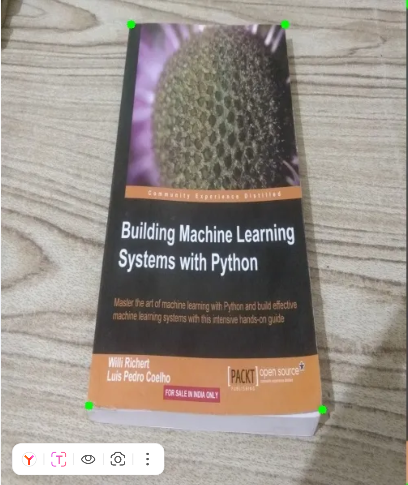
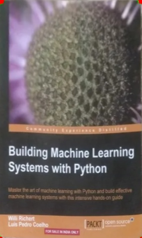

# Основы компьютерного зрения на OpenCV

Учебный проект-практикум по компьютерному зрению: последовательное освоение классических методов CV на **OpenCV** — от базовых операций с изображением до итогового мини-проекта, определяющего, помещается ли объект в контейнер.


## О проекте

Каждый ноутбук — это отдельная тема практикума, изученная на реальных фотографиях (яблоко, воздушный шарик, кристалл, стол). Финальный ноутбук объединяет несколько тем в одну прикладную задачу: перспективная коррекция снимка сверху + поиск контуров + сравнение габаритов объекта и контейнера.

## Содержание

| № | Ноутбук | Тема | Ключевые методы |
|---|---------|------|------------------|
| 1 | [`1_introduction_to_open_cv.ipynb`](1_introduction_to_open_cv.ipynb) | Основы OpenCV | чтение/запись изображений, ROI (обрезка), масштабирование с сохранением пропорций |
| 2 | [`2_simple_color_filters.ipynb`](2_simple_color_filters.ipynb) | Цветовые фильтры | HSV-сегментация, `inRange`, поиск центра масс объекта |
| 3 | [`3_blurring_and_threshold_filtering.ipynb`](3_blurring_and_threshold_filtering.ipynb) | Размытие и пороги | `blur`, виды `threshold` (BINARY/TRUNC/TOZERO…), адаптивная бинаризация |
| 4 | [`4_morphology.ipynb`](4_morphology.ipynb) | Морфология | `erode`/`dilate`/`OPEN`/`CLOSE`, очистка масок цветовой сегментации |
| 5 | [`5_Hough_transformations.ipynb`](5_Hough_transformations.ipynb) | Преобразование Хафа | `HoughLinesP`, `HoughCircles`, поиск углов по пересечению линий |
| 6 | [`6_boundary_detectors.ipynb`](6_boundary_detectors.ipynb) | Детекторы границ | Canny, комбинация с HSV-маской и `floodFill` для замкнутого контура |
| 7 | [`7_angle_detection.ipynb`](7_angle_detection.ipynb) | Детекторы углов | Harris, Shi-Tomasi (`goodFeaturesToTrack`), площадь многоугольника по формуле Гаусса |
| 8 | [`8_affine_transformations.ipynb`](8_affine_transformations.ipynb) | Геометрические преобразования | `warpAffine`, `warpPerspective`, интерактивный выбор углов мышью, вид «сверху» |
| 9 | [`9_final_boss.ipynb`](9_final_boss.ipynb) | Итоговый проект | перспективная коррекция + поиск контуров + проверка «помещается / не помещается» |

## Пример результата

Перспективная коррекция снимка, сделанного под углом, в вид «сверху» (ноутбук 8):

<p align="center">
  
  &nbsp;&nbsp;
  
</p>

## Технологии

- Python 3
- OpenCV (`opencv-python`)
- NumPy
- Matplotlib — для наглядной визуализации масок и порогов
- Jupyter Notebook

## Запуск

```bash
python -m venv venv
venv\Scripts\activate        # Windows
pip install -r requirements.txt
jupyter notebook
```

Ячейки с `cv2.imshow` открывают окна с изображением и ждут нажатия любой клавиши (`cv2.waitKey(0)`) — выполнять их нужно локально, а не в облачных средах без GUI (Colab и т.п.).

## Структура репозитория

```
.
├── 1_introduction_to_open_cv.ipynb
├── 2_simple_color_filters.ipynb
├── 3_blurring_and_threshold_filtering.ipynb
├── 4_morphology.ipynb
├── 5_Hough_transformations.ipynb
├── 6_boundary_detectors.ipynb
├── 7_angle_detection.ipynb
├── 8_affine_transformations.ipynb
├── 9_final_boss.ipynb
├── images/                  # исходные и результирующие изображения к ноутбукам
├── requirements.txt
└── README.md
```

## Автор

igork
